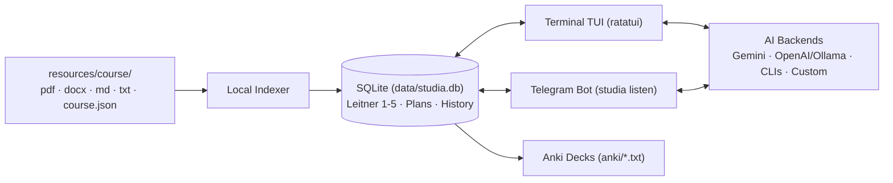

<div align="center">

# studia

**Bilingual (`EN` / `TR`), local-first AI study assistant for your own notes — with a Terminal TUI, Telegram Bot, Leitner spaced repetition, and Anki export in one Rust binary.**

**English** · [Türkçe](README.tr.md)

[](LICENSE)
[](Cargo.toml)
[](https://github.com/zodicall/studia/releases)

[Features](#features) · [Architecture](#how-it-works) · [Quickstart](#quickstart) · [AI Backends](#ai-backend-configuration) · [Telegram Bot](#telegram-bot-setup) · [Commands](#cli-tui--bot-commands) · [Security](SECURITY.md)

</div>

---

`studia` indexes your local study materials (`pdf`, `docx`, `md`, `txt`), organizes optional course plans and mock exams via `course.json`, runs interactive quizzes and 5-box Leitner spaced-repetition reviews, exports Anki flashcard decks, and stays synchronized across a **terminal TUI** (`ratatui`) and a **Telegram bot** (`studia listen`) backed by a single local SQLite database (`data/studia.db`).

## Features

- **Terminal TUI & Telegram Bot**: Study locally in a 6-tab keyboard-driven terminal UI (`Ask`, `Quiz`, `Review`, `Stats`, `Today`, `Exams`) or remotely via Telegram using the same SQLite database (`data/studia.db`).
- **Live Bilingual Experience (`en` / `tr`)**: Auto-detects OS language (`--lang > stored > STUDIA_LANG > OS locale > en`), switchable live with `F4` in the TUI or `/lang tr|en` in Telegram/TUI.
- **Course-Agnostic Design**: Drop notes under `resources/<course>/` and optionally customize persona, mock exam question counts/categories/rules, and multi-day study plans in `course.json`.
- **Flexible AI Backends**: Works with Gemini HTTP API, OpenAI (or Ollama / any OpenAI-compatible endpoint via `STUDIA_AI_BASE_URL`), AI CLIs (`agy`, `claude`, `codex`), or custom command templates (`STUDIA_AI_PROVIDER=custom`).
- **Spaced Repetition & Anki**: Incorrect answers enter a 5-box Leitner schedule and generate fresh AI variation questions on review; flashcards export directly to tab-separated `.txt` decks under `anki/`.
- **Offline Diagnostics**: `studia doctor` verifies `resources/`, `curl`, `pdftotext`, AI configuration, `.env` file permissions, and SQLite integrity (`PRAGMA quick_check`).

## How It Works



## Quickstart

### Prerequisites

- **Prebuilt Binary** from [GitHub Releases](https://github.com/zodicall/studia/releases) (`windows-msvc`, `linux-gnu`, `macos-intel`, `macos-apple-silicon`), **or Rust 1.89+** to build from source (`cargo build --release --locked`)
- **`curl`** on `PATH` (for Telegram API & HTTP AI requests)
- **`pdftotext`** (Poppler, optional fallback — a built-in PDF text extractor is included; `.md`, `.txt`, `.docx`, and standard `.pdf` files work out of the box)

### Install & Run

```bash
git clone https://github.com/zodicall/studia.git
cd studia
cargo build --release --locked
```

1. Copy the environment template and configure an AI provider:

   ```bash
   cp .env.example .env
   chmod 600 .env   # recommended on Unix/macOS
   ```

2. Create a course folder and add your study notes (or copy a template from [`examples/`](examples/)):

   ```bash
   mkdir -p resources/Calculus
   # Add .md, .txt, .docx, or .pdf files inside resources/Calculus/
   cp examples/general-course/course.json resources/Calculus/course.json
   ```

3. Run offline diagnostics, index sources, and launch the TUI:

   ```bash
   cargo run --release -- doctor
   cargo run --release -- index
   cargo run --release
   ```

## AI Backend Configuration

> [!NOTE]
> Configuration precedence is **OS environment > `<root>/.env` > `<root>/data/.env`**. Secrets are scrubbed from error logs and stripped before launching external AI CLI subprocesses.

| Variable | Description | Default |
| :--- | :--- | :--- |
| `STUDIA_AI_PROVIDER` | `auto`, `gemini`, `openai`, `agy`, `claude`, `codex`, `custom` | `auto` |
| `STUDIA_AI_MODEL` | Optional model override | Provider default |
| `STUDIA_AI_EFFORT` | Optional reasoning effort (`minimal` \| `low` \| `medium` \| `high` \| `xhigh` \| `max`) | Provider default |
| `STUDIA_AI_BASE_URL` | Custom API endpoint (e.g., `http://localhost:11434/v1` for Ollama) | Provider default |
| `GEMINI_API_KEY` | Google Gemini API key (also supports `STUDIA_GEMINI_API_KEY`) | — |
| `OPENAI_API_KEY` | OpenAI / compatible API key (also supports `STUDIA_OPENAI_API_KEY`, `STUDIA_AI_API_KEY`) | — |
| `STUDIA_AI_CMD` | Command template for `custom` provider (`{prompt_file}`, `{schema_file}`) | — |
| `STUDIA_AI_TIMEOUT_SECS` | Timeout in seconds (`0` disables timeout) | `180` |
| `STUDIA_LANG` | Startup UI/prompt language (`en` \| `tr`) | Auto-detected |

When `STUDIA_AI_PROVIDER=auto`, the order checked is: `GEMINI_API_KEY` → `OPENAI_API_KEY` → `agy` → `claude` → `codex` in `PATH`.

## Telegram Bot Setup

1. Create a bot via `@BotFather` and retrieve your bot token and numeric chat ID.
2. Add credentials to `.env`:

   ```env
   STUDIA_TELEGRAM_TOKEN=123456:your-bot-token
   STUDIA_TELEGRAM_CHAT_ID=123456789
   STUDIA_MORNING=08:30
   ```

3. Start the listener standalone or toggle it inside the TUI with `F2`:

   ```bash
   studia listen
   ```

> [!IMPORTANT]
> Only messages and inline callbacks matching `STUDIA_TELEGRAM_CHAT_ID` are processed; updates from any other chat or group are silently ignored.

## Customizing Courses (`course.json`)

Place an optional `course.json` inside `resources/<course>/` to tailor:

- **`title` & `persona`**: Display name and AI tutor instructions.
- **`exam`**: Question count (`1..=200`), choices count (`4` or `5`), weighted categories, and exam rules.
- **`plan`**: Sequential day-by-day checklist (`day`, `title`, `tasks` with optional slash `command` + `label`).

Ready-to-use, copyright-free templates are included in:
- [`examples/general-course/course.json`](examples/general-course/course.json)
- [`examples/academic-english/course.json`](examples/academic-english/course.json)

## CLI, TUI & Bot Commands

### CLI Usage

```text
studia [--root <dir>] [--lang tr|en] [tui|listen|index|doctor]
studia --help | -h
studia --version | -V
```

### TUI Shortcuts

| Key | Action |
| :--- | :--- |
| `1`–`6` / `Tab` / `Shift+Tab` | Switch tabs (`Ask`, `Quiz`, `Review`, `Stats`, `Today`, `Exams`) |
| `↑` / `↓` | Switch active course (or move between Today tasks / Exam history items) |
| `F1` / `?` | Open / close Help overlay |
| `F2` | Start / stop background Telegram listener |
| `F3` | Toggle AI Coach (auto-picks and launches next study step) |
| `F4` | Switch UI & AI prompt language live (`EN` ↔ `TR`) |
| `F5` | Open AI Provider & Model settings modal (`.env` + live connection test) |
| `g` / `e` *(Today)* | Generate an AI study plan (`g`) or edit days/tasks manually (`e`) |
| `Enter` | Submit command, start study task, or open prompt |
| `Esc` | Cancel input / end active quiz or background AI job |

### Bilingual Bot & TUI Slash Commands

All commands accept both English and Turkish aliases:

| English | Turkish | Purpose |
| :--- | :--- | :--- |
| `/help` | `/yardim` | Show command summary & menu |
| `/courses` | `/dersler` | List courses with stats & inline selector |
| `/course <name>` | `/ders <ad>` | Switch active course |
| `/explain <topic>` *(also `/lesson`)* | `/anlat <konu>` | Guided lesson + 5-question quick check |
| `/quiz [topic] [n]` | `/quiz [konu] [n]` | Generate or replay saved questions |
| `/practice <topic> [n]` | `/kazanim <konu> [n]` | Focused quick-check practice |
| `/review [n] [exact]` | `/tekrar [n] [orijinal]` | Review due mistakes (AI variations or exact) |
| `/cards <topic> [n]` | `/kelime <konu> [n]` | Generate concept/vocabulary Anki deck |
| `/exam [n]` | `/deneme [n]` | Start full mock exam |
| `/exams [index]` | `/denemeler [sıra]` | View mock exam history & AI coaching breakdown |
| `/mistakes` | `/yanlislar` | Due review counts across courses |
| `/today` | `/bugun` | Today's study plan checklist |
| `/plan [start\|day\|goto\|create\|edit]` | `/plan [baslat\|gun\|gec\|olustur\|duzenle]` | Inspect, AI-generate, or edit study plan |
| `/ai` *(or `/settings`)* | `/ai` *(veya `/ayarlar`)* | Open TUI AI provider & model configuration |
| `/model [name]` | `/model [ad]` | Set default AI model in `.env` (or open AI settings) |
| `/effort [level]` | `/effort [seviye]` | Set reasoning effort (`minimal`..`max`, `default`) in `.env` |
| `/lang <tr\|en>` | `/lang <tr\|en>` | Switch language persistently |
| `/test` | `/test` | Run a local offline sample question |
| `/cancel` | `/iptal` | Cancel running AI job or active quiz |

## Troubleshooting (`doctor`)

Run `studia doctor` to diagnose setup issues offline:
- **`[FAIL] curl not found`**: Install `curl` and ensure it is in `PATH`.
- **`[INFO] pdftotext: not installed`**: Optional fallback only; the built-in PDF text extractor is active. Install Poppler (`pdftotext`) if you need fallback extraction for complex PDFs.
- **`[WARN] Env file permissions are too broad`**: Restrict `.env` permissions (`chmod 600 .env`) on Unix/macOS.
- **`[WARN] non-loopback http://`**: Prefer `https://` for remote `STUDIA_AI_BASE_URL` endpoints.

## Disclaimer, Third-Party Notices & Privacy

- **AI Accuracy & No Outcome Guarantee**: AI-generated explanations, quizzes, Leitner review variations, and coaching feedback may contain inaccuracies or hallucinations and are provided for study assistance only, with no guarantee of academic, grading, or exam outcomes.
- **Non-Affiliation & Trademarks**: `studia` is an independent open-source project. Telegram, Google Gemini, OpenAI, Anthropic Claude, Anki, Ollama, and other referenced names/services are trademarks of their respective owners; users are solely responsible for complying with the Terms of Service of any external provider they configure.
- **Self-Hosted Privacy (KVKK / GDPR)**: `studia` runs locally on your machine, sends indexed note excerpts and prompts only to the AI and Telegram APIs you configure, and stores study history and runtime logs locally in `data/studia.db` and `data/bot.log`. Operators must avoid uploading personal, confidential, or copyrighted third-party materials without proper authorization.

## Security, Contributing & License

- **Security:** See [SECURITY.md](SECURITY.md) for the local-first threat model, secret isolation guarantees, and private vulnerability reporting.
- **Contributing:** See [CONTRIBUTING.md](CONTRIBUTING.md) for specs, checks, and localization guidelines, and [CHANGELOG.md](CHANGELOG.md) for release notes.
- **License:** Distributed under the [MIT License](LICENSE). Third-party dependency notices are bundled in [THIRD_PARTY_NOTICES.txt](THIRD_PARTY_NOTICES.txt).
