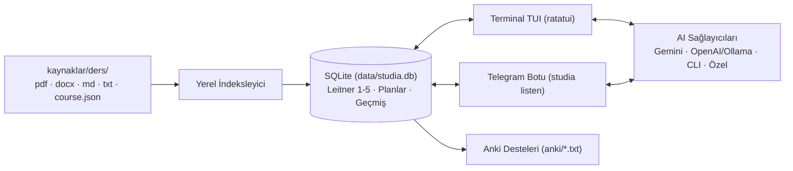

<div align="center">

# studia

**Kendi notlarınızla çalışan, çift dilli (`TR` / `EN`), yerel öncelikli yapay zeka çalışma asistanı — tek Rust ikilisinde Terminal TUI, Telegram Botu, Leitner aralıklı tekrar ve Anki dışa aktarımı.**

[English](README.md) · **Türkçe**

[](LICENSE)
[](Cargo.toml)
[](https://github.com/zodicall/studia/releases)

[Özellikler](#özellikler) · [Mimari](#nasıl-çalışır) · [Hızlı Başlangıç](#hızlı-başlangıç) · [Yapay Zeka](#yapay-zeka-sağlayıcı-ayarları) · [Telegram Botu](#telegram-bot-kurulumu) · [Komutlar](#cli-tui-ve-bot-komutları) · [Güvenlik](SECURITY.md)

</div>

---

`studia`, yerel ders materyallerinizi (`pdf`, `docx`, `md`, `txt`) indeksler, isteğe bağlı `course.json` dosyalarıyla derse özel çalışma planları ve deneme sınavları yönetir, etkileşimli quizler ve 5 kutulu Leitner aralıklı tekrar oturumları yürütür, Anki bilgi kartı desteleri üretir ve tek bir yerel SQLite veritabanı (`data/studia.db`) üzerinden hem **terminal TUI** (`ratatui`) hem de **Telegram botu** (`studia listen`) olarak çalışır.

## Özellikler

- **Terminal Arayüzü (TUI) ve Telegram Botu**: 6 sekmeli klavye odaklı terminal arayüzünden (`Sor`, `Quiz`, `Tekrar`, `İstatistik`, `Bugün`, `Denemeler`) veya Telegram üzerinden (`studia listen`) aynı ilerleme ve veritabanıyla (`data/studia.db`) çalışın.
- **Canlı Çift Dil Desteği (`tr` / `en`)**: Başlangıçta sistem dilini otomatik algılar (`--lang > veritabanı > STUDIA_LANG > sistem dili > en`); çalışma sırasında TUI'da `F4` tuşuyla veya bot/TUI komut satırında `/lang tr|en` ile anında değiştirilebilir.
- **Dersten Bağımsız Yapı**: `kaynaklar/<ders>/` altına notlarınızı ekleyin; isterseniz `course.json` ile eğitmen kimliği, deneme sınavı soru/şık sayısı, kategori dağılımı ve günlük çalışma planı tanımlayın.
- **Esnek Yapay Zeka Sağlayıcıları**: Gemini HTTP API, OpenAI (veya `STUDIA_AI_BASE_URL` üzerinden Ollama gibi OpenAI uyumlu sunucular), CLI araçları (`agy`, `claude`, `codex`, `gemini`) ve özel komut şablonları (`STUDIA_AI_PROVIDER=custom`) desteklenir.
- **Aralıklı Tekrar ve Anki Kartları**: Yanlış yanıtlanan sorular 5 kutulu Leitner tekrar kuyruğuna alınır ve tekrarda aynı kuralı farklı bağlamda test eden taze varyasyonlar üretilir; kavram kartları `anki/` altına `.txt` olarak kaydedilir.
- **Çevrimdışı Sistem Kontrolü**: `studia doctor` komutu `kaynaklar/`, `curl`, `pdftotext`, AI ayarları, `.env` dosya izinleri ve SQLite bütünlüğünü (`PRAGMA quick_check`) denetler.

## Nasıl Çalışır?



## Hızlı Başlangıç

### Gereksinimler

- [GitHub Releases](https://github.com/zodicall/studia/releases) üzerinden **hazır sürüm ikilisi** (`windows-msvc`, `linux-gnu`, `macos-intel`, `macos-apple-silicon`) **veya kaynak koddan derleme için Rust 1.89+** (`cargo build --release --locked`)
- `PATH` içinde **`curl`** (Telegram ve HTTP AI istekleri için)
- **`pdftotext`** (Poppler, isteğe bağlı fallback — gömülü PDF metin okuyucu dahildir; `.md`, `.txt`, `.docx` ve standart `.pdf` dosyaları ek araç gerektirmeden çalışır)

### Kurulum ve Çalıştırma

```bash
git clone https://github.com/zodicall/studia.git
cd studia
cargo build --release --locked
```

1. Örnek ortam dosyasını kopyalayın ve AI sağlayıcınızı ayarlayın:

   ```bash
   cp .env.example .env
   chmod 600 .env   # Unix/macOS üzerinde önerilir
   ```

2. Bir ders klasörü oluşturup kaynak belgelerinizi ekleyin (isterseniz [`examples/`](examples/) içindeki şablonlardan birini kopyalayın):

   ```bash
   mkdir -p kaynaklar/Matematik
   # kaynaklar/Matematik/ içine .md, .txt, .docx veya .pdf dosyaları ekleyin
   cp examples/general-course/course.json kaynaklar/Matematik/course.json
   ```

3. Sistem kontrolünü çalıştırın, kaynakları indeksleyin ve TUI'yı başlatın:

   ```bash
   cargo run --release -- doctor
   cargo run --release -- index
   cargo run --release -- --lang tr
   ```

## Yapay Zeka Sağlayıcı Ayarları

> [!NOTE]
> Öncelik sırası: **İşletim sistemi ortam değişkenleri > `<root>/.env` > `<root>/data/.env`**. Gizli anahtarlar hata loglarından temizlenir ve harici AI CLI alt süreçleri başlatılmadan önce ortamdan kaldırılır.

| Değişken | Açıklama | Varsayılan |
| :--- | :--- | :--- |
| `STUDIA_AI_PROVIDER` | `auto`, `gemini`, `openai`, `agy`, `claude`, `codex`, `gemini-cli`, `custom` | `auto` |
| `STUDIA_AI_MODEL` | İsteğe bağlı model adı | `gemini-2.5-flash` / `gpt-4o-mini` |
| `STUDIA_AI_BASE_URL` | Özel API adresi (örn. yerel Ollama için `http://localhost:11434/v1`) | Sağlayıcı varsayılanı |
| `GEMINI_API_KEY` | Gemini API anahtarı (`STUDIA_GEMINI_API_KEY` de desteklenir) | — |
| `OPENAI_API_KEY` | OpenAI / uyumlu API anahtarı (`STUDIA_OPENAI_API_KEY`, `STUDIA_AI_API_KEY`) | — |
| `STUDIA_AI_CMD` | `custom` sağlayıcı için komut şablonu (`{prompt_file}`, `{schema_file}`) | — |
| `STUDIA_AI_TIMEOUT_SECS` | Alt süreç AI zaman aşımı saniyesi (`0` devre dışı bırakır) | `180` |
| `STUDIA_LANG` | Başlangıç dili (`tr` \| `en`) | Otomatik |

`STUDIA_AI_PROVIDER=auto` iken kontrol sırası: `GEMINI_API_KEY` → `OPENAI_API_KEY` → `PATH` üzerinde `agy` → `claude` → `codex` → `gemini`.

## Telegram Bot Kurulumu

1. `@BotFather` ile bot oluşturup bot token'ını ve sayısal sohbet kimliğinizi (`chat_id`) alın.
2. `.env` dosyanıza ekleyin:

   ```env
   STUDIA_TELEGRAM_TOKEN=123456:bot-token
   STUDIA_TELEGRAM_CHAT_ID=123456789
   STUDIA_MORNING=08:30
   ```

3. Dinleyiciyi doğrudan veya TUI içinde `F2` ile başlatın:

   ```bash
   studia listen
   ```

> [!IMPORTANT]
> Bot yalnızca `STUDIA_TELEGRAM_CHAT_ID` ile eşleşen sohbetten gelen mesajları ve buton basımlarını işler; diğer sohbet veya gruplardan gelen güncellemeler sessizce yok sayılır.

## Ders Özelleştirme (`course.json`)

İsteğe bağlı olarak `kaynaklar/<ders>/course.json` ekleyerek şunları tanımlayabilirsiniz:

- **`title` & `persona`**: Görünen ders adı ve yapay zeka eğitmen yönergesi.
- **`exam`**: Soru sayısı (`1..=200`), şık sayısı (`4` veya `5`), kategori dağılımı ve sınav kuralları.
- **`plan`**: Sıralı günlük çalışma planı (`day`, `title`, `tasks`: komut + etiket).

Hazır, telif hakkı içermeyen örnek şablonlar:
- [`examples/general-course/course.json`](examples/general-course/course.json)
- [`examples/academic-english/course.json`](examples/academic-english/course.json)

## CLI, TUI ve Bot Komutları

### CLI Kullanımı

```text
studia [--root <dizin>] [--lang tr|en] [tui|listen|index|doctor]
studia --help | -h
studia --version | -V
```

### TUI Kısayolları

| Tuş | İşlev |
| :--- | :--- |
| `1`–`6` / `Tab` / `Shift+Tab` | Sekme değiştir (`Sor`, `Quiz`, `Tekrar`, `İstatistik`, `Bugün`, `Denemeler`) |
| `↑` / `↓` | Aktif dersi değiştir (veya Bugün/Denemeler listesinde gezin) |
| `F1` / `?` | Yardım penceresini aç/kapat |
| `F2` | Telegram dinleyicisini başlat/durdur |
| `F3` | AI Koçu aç/kapat (bir sonraki çalışma adımını seçip başlatır) |
| `F4` | Arayüz ve AI dilini canlı değiştir (`TR` ↔ `EN`) |
| `Enter` | Komut çalıştır, görevi başlat veya girdi aç |
| `Esc` | Girdiyi iptal et / aktif quiz veya arka plan AI işini sonlandır |

### Çift Dilli Komutlar

Tüm komutların hem Türkçe hem İngilizce biçimi geçerlidir:

| Türkçe | İngilizce | Açıklama |
| :--- | :--- | :--- |
| `/yardim` | `/help` | Komut özeti ve menü |
| `/dersler` | `/courses` | Dersleri istatistiklerle listele |
| `/ders <ad>` | `/course <name>` | Aktif dersi değiştir |
| `/anlat <konu>` | `/explain <topic>` *(ve `/lesson`)* | Konu anlatımı + 5 soruluk kazanım testi |
| `/quiz [konu] [n]` | `/quiz [topic] [n]` | Yeni quiz üret veya kayıtlı soruları çöz |
| `/kazanim <konu> [n]` | `/practice <topic> [n]` | Odaklı pekiştirme testi |
| `/tekrar [n] [orijinal]` | `/review [n] [exact]` | Zamanı gelen yanlışları tekrar et |
| `/kelime <konu> [n]` | `/cards <topic> [n]` | Anki için kavram/kelime kartı destesi üret |
| `/deneme [n]` | `/exam [n]` | Tam deneme sınavı başlat |
| `/denemeler [sıra]` | `/exams [index]` | Geçmiş denemeler ve AI koç analizi |
| `/yanlislar` | `/mistakes` | Derslere göre tekrar sayıları |
| `/bugun` | `/today` | Bugünün çalışma planı görevleri |
| `/plan [baslat\|gun\|gec]` | `/plan [start\|day\|goto]` | Çalışma planını başlat veya incele |
| `/lang <tr\|en>` | `/lang <tr\|en>` | Dili kalıcı olarak değiştir |
| `/test` | `/test` | Çevrimdışı örnek soru dene |
| `/iptal` | `/cancel` | Çalışan AI işini veya quizi iptal et |

## Sorun Giderme (`doctor`)

Kurulum sorunlarını çevrimdışı incelemek için `studia doctor` çalıştırın:
- **`curl bulunamadı`**: `curl` kurup `PATH` dizinine ekleyin.
- **`pdftotext: yüklü değil`**: Yalnızca isteğe bağlı fallback içindir; gömülü PDF metin okuyucu aktiftir. Karmaşık PDF'lerde ek çıkarma gerekirse Poppler (`pdftotext`) kurabilirsiniz.
- **`Ortam dosyası izinleri çok açık`**: Unix/macOS'ta `chmod 600 .env` uygulayın.
- **`non-loopback http://`**: Uzak sunucu adreslerinde mümkünse `https://` kullanın.

## Sorumluluk Reddi, Üçüncü Taraf Bildirimleri ve Gizlilik

- **Yapay Zeka Doğruluğu ve Başarı Garantisi Olmaması**: Yapay zeka tarafından üretilen konu anlatımları, quizler, Leitner tekrar varyasyonları ve koçluk geri bildirimleri hatalar veya halüsinasyonlar içerebilir; yalnızca çalışma desteği amaçlıdır ve akademik başarı veya sınav sonucu garantisi vermez.
- **Bağlantısızlık ve Ticari Markalar**: `studia` bağımsız bir açık kaynak projesidir. Telegram, Google Gemini, OpenAI, Anthropic Claude, Anki, Ollama ve anılan diğer ad/hizmetler ilgili sahiplerinin ticari markalarıdır; yapılandırdığınız harici sağlayıcıların Kullanım Koşullarına uymak tamamen kullanıcının sorumluluğundadır.
- **Kendi Sunucunuzda Gizlilik (KVKK / GDPR)**: `studia` makinenizde yerel olarak çalışır; yalnızca yapılandırdığınız AI ve Telegram API'lerine indekslenmiş not kesitlerini ve istemleri gönderir, çalışma geçmişi ile çalışma günlüklerini yerel olarak `data/studia.db` ve `data/bot.log` içinde saklar. İşleticiler, izinsiz kişisel veri, gizli bilgi veya telif hakkıyla korunan üçüncü taraf materyalleri yüklemekten kaçınmalıdır.

## Güvenlik, Katkı ve Lisans

- **Güvenlik:** Yerel öncelikli tehdit modeli, gizli anahtar izolasyonu ve özel güvenlik açığı bildirimi için [SECURITY.md](SECURITY.md) dosyasına bakın.
- **Katkı:** Şartnameler, kontroller ve yerelleştirme yönergeleri için [CONTRIBUTING.md](CONTRIBUTING.md), sürüm notları için [CHANGELOG.md](CHANGELOG.md) dosyasına bakın.
- **Lisans:** [MIT Lisansı](LICENSE) ile dağıtılır. Üçüncü taraf bağımlılık bildirimleri [THIRD_PARTY_NOTICES.txt](THIRD_PARTY_NOTICES.txt) içindedir.
